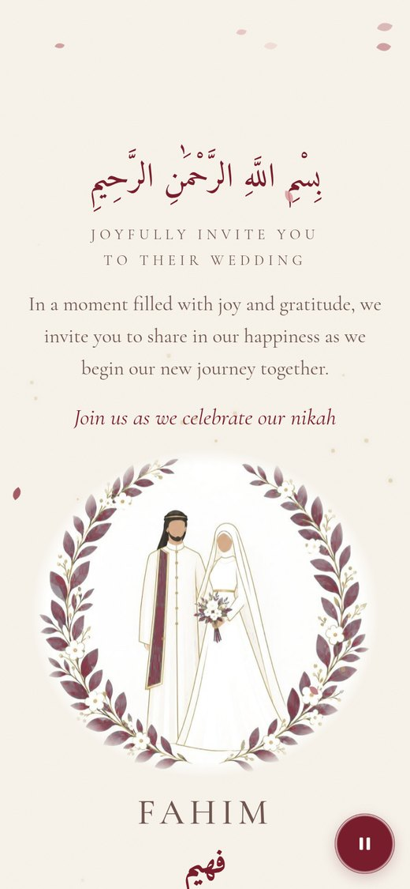
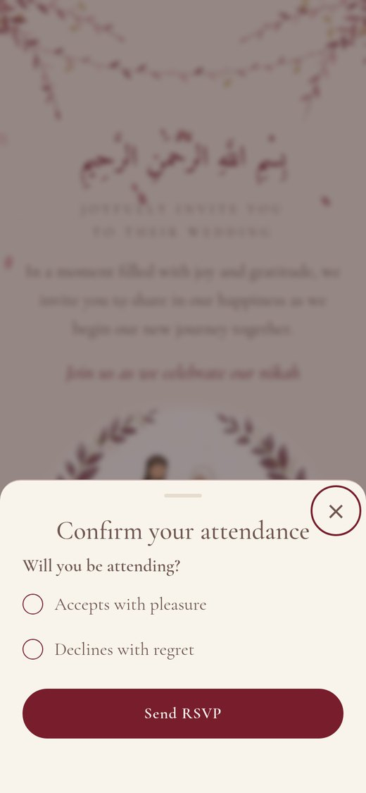
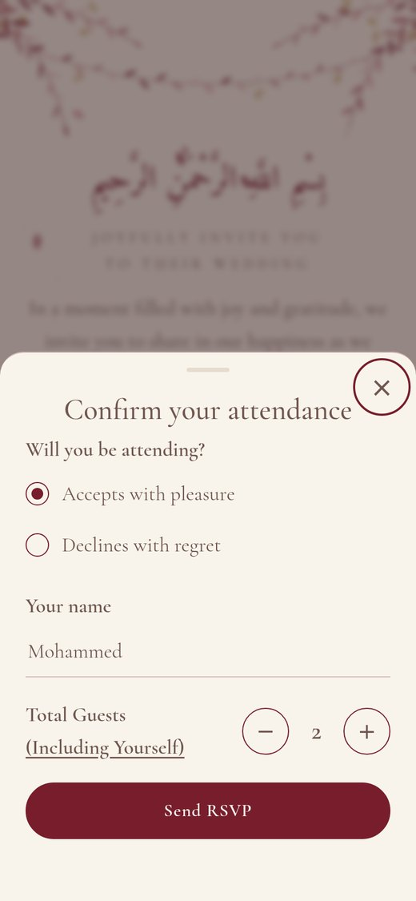
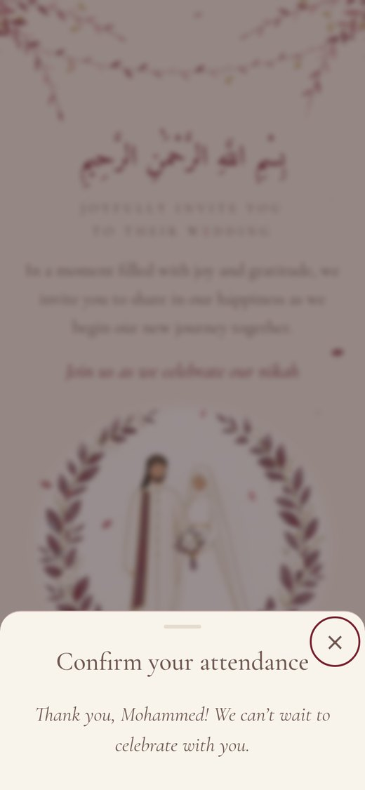

# Fahim & Marwa · Private wedding invitation

A private, mobile-first wedding invitation with personal guest links, live RSVPs and an
installable dashboard for the couple. Laravel 12 + SQLite, Blade, plain CSS and vanilla JS.
`SPEC.md` is the full specification; `reference/index.php` is the original single-file prototype.

| Part | URL |
|---|---|
| Invitation (one per guest) | `/i/{token}` |
| Private notice | `/` and every unknown address (HTTP 404) |
| Dashboard | `/admin` (installable as a phone app) |
| First-run setup | `/admin/setup`, only until the admin exists |

## Screenshots

What a guest sees on a phone (taken from a copy with demo data):

<table>
  <tr>
    <td align="center"><br><sub>1. Envelope, tap the seal</sub></td>
    <td align="center"><br><sub>2. The invitation</sub></td>
    <td align="center"><br><sub>3. RSVP card</sub></td>
    <td align="center"><br><sub>4. Name and guests</sub></td>
    <td align="center"><br><sub>5. Reply sent</sub></td>
  </tr>
</table>

## Run it locally

Requirements: PHP 8.2+ with `pdo_sqlite`, `gd`, `mbstring`, `fileinfo`; Composer; Node 18+ (only to rebuild assets).

```bash
composer install
cp .env.example .env            # Windows: copy .env.example .env
php artisan key:generate
touch database/database.sqlite  # Windows: type nul > database\database.sqlite
php artisan migrate
php artisan storage:link
php artisan db:seed --class=DemoSeeder   # optional: the wedding details + 6 sample guests
php artisan serve
```

Open http://127.0.0.1:8000/admin and create your account, or create it from the command line:
`php artisan wedding:admin`.

- Tests: `./vendor/bin/pest` (85 tests covering all 19 acceptance criteria; the test tools need PHP 8.3+).
- Assets: the compiled CSS and JS are committed in `public/build`, so hosting needs no Node.
  After changing `resources/css` or `resources/js`, run `npm install && npm run build`
  (or `npm run dev` while working).

## Commands

| Command | What it does |
|---|---|
| `php artisan wedding:admin` | Creates the single admin, or resets its email and password (also signs out every session). Options: `--name --email --password`. |
| `php artisan wedding:backup` | Snapshots the SQLite database to `storage/app/backups/` and keeps the newest 14. Scheduled daily at 03:00 Bahrain time. |
| `php artisan db:seed --class=DemoSeeder` | Saves the default details and adds 6 sample invitations. |

## Choices made where the spec left room

- **Laravel 12, not 11.** Composer refuses every Laravel 11 release because of open security
  advisories (11.x is out of security support). Laravel 12 has the same structure and APIs.
- **Timezone.** `APP_TIMEZONE=Asia/Bahrain` is the *display* zone (`config/wedding.php`).
  The app itself runs in UTC, so every stored timestamp is UTC, as the spec requires.
- **Mobile app dashboard** (requested during the build). The dashboard is an installable web
  app (`public/manifest.webmanifest`, icons in `public/icons`) with a sticky top bar, a bottom
  tab bar (Overview · Guests · Add · Invitation), bottom sheets for guest actions and
  confirmations, toasts, and a badge on Guests for replies that arrived since you last looked.
  The spec's dashboard sections are kept and grouped into these four screens. On a wide
  screen, the tab bar moves to the top. There is deliberately no service worker, so the private
  guest list is never cached offline.
- **The RSVP dialog** opens as a bottom sheet on phones and as a centred dialog on wider screens.
- **Music setting.** The `music` switch is part of the details form. Saving it also writes the
  `music` setting (`{state: on|off, theme: nahawand}`) that the guest page reads.
- **Photos** are always re-encoded to JPEG (quality 85, at most 1600 px) and saved as
  `storage/app/public/invitation/{couple|venue}.jpg` with `?v={timestamp}`.
- **Arabic in the PDF.** dompdf cannot join Arabic letters or lay them out right to left, so
  Arabic text is shaped with `khaled.alshamaa/ar-php` and set in the embedded Amiri font.
- **CSV export** is linked in the Overview footer (the spec names the route but not where it goes).
- **Add to calendar in the preview** works without a guest link: the preview embeds the same
  `.ics` file as a data link.
- **RSVP rate limit** is 10 a minute per invitation token (a named limiter); login is 5 a minute
  per email + IP; setup is 5 a minute.
- **Bulk add** accepts commas, semicolons or tabs, skips a `name,…` header row, and adds at
  most 500 lines at a time.
- **CSV safety.** Cells that start with `=`, `+`, `-` or `@` are prefixed with `'` so
  spreadsheet apps don't run them as formulas.

## Deploying

Before you go live, in `.env`:

```
APP_ENV=production
APP_DEBUG=false
APP_URL=https://yourdomain
APP_TIMEZONE=Asia/Bahrain
DB_CONNECTION=sqlite
SESSION_DRIVER=database
SESSION_SECURE_COOKIE=true
CACHE_STORE=database
QUEUE_CONNECTION=sync
```

### Shared hosting (cPanel)

1. Locally run `composer install --no-dev --optimize-autoloader` (`public/build` is already built).
2. Upload the project to a folder **above** `public_html`, e.g. `~/wedding`.
3. Point the domain's document root at `~/wedding/public`. If you can't, copy the contents of
   `public/` into `public_html` and change the two paths in `public_html/index.php` to `../wedding/…`.
4. Create `database/database.sqlite` (an empty file) and set `.env` as above.
5. In cPanel → Terminal (or SSH):
   ```bash
   php artisan key:generate
   php artisan migrate --force
   php artisan storage:link
   php artisan config:cache && php artisan route:cache && php artisan view:cache
   ```
6. Make `storage/`, `bootstrap/cache/` and `database/` writable by PHP (755 for folders, 644 for files).
7. Turn on HTTPS (cPanel → SSL/TLS Status → AutoSSL).
8. Add a cron job (cPanel → Cron Jobs, daily): `php ~/wedding/artisan wedding:backup`.
9. Check that `https://yourdomain/database/database.sqlite` and `https://yourdomain/.env` both
   return "not found".

### VPS (Nginx + PHP-FPM 8.2+)

1. `git clone`, then `composer install --no-dev --optimize-autoloader`.
2. Install `php8.x-fpm php8.x-sqlite3 php8.x-gd php8.x-mbstring php8.x-xml php8.x-intl`.
3. Nginx `root /var/www/wedding/public;` with the standard Laravel `try_files $uri $uri/ /index.php?$query_string;`
   location and `fastcgi_pass` to PHP-FPM. Get a certificate with Certbot and redirect HTTP to HTTPS.
4. Same artisan steps as above. `chown -R www-data:www-data storage bootstrap/cache database`.
5. Cron: `* * * * * cd /var/www/wedding && php artisan schedule:run >> /dev/null 2>&1`
   (runs the daily backup).
6. If a proxy or load balancer terminates TLS in front of Nginx, add
   `$middleware->trustProxies(at: '*')` in `bootstrap/app.php`.

### First run

Open `https://yourdomain/admin` and create the admin account straight away. Then save the
details, upload the photos, add guests, send yourself a link and test a reply. Clear that reply
before sending links to guests. On your phone, use "Add to Home Screen" to install the dashboard.

## Files

```
app/
  Console/Commands/      CreateAdmin (wedding:admin), BackupDatabase (wedding:backup)
  Http/Controllers/      PrivateNotice, Invitation, Rsvp, Setup, Auth, Dashboard, Invitee, Details, Photo, Export
  Http/Middleware/       EnsureNoAdmin (no.admin), SecurityHeaders (global)
  Http/Requests/         Rsvp, Details, Invitee, BulkInvitee, Photo, Setup, Login
  Models/                Invitee, RsvpLog, Setting, User
  Services/              Settings, InvitationDetails, GuestStats, IcsBuilder, PdfText
bootstrap/app.php        middleware, guest redirects, { ok:false, error } JSON errors
config/wedding.php       display timezone, seat limit, photo slots, backups kept
database/migrations/     invitees, rsvp_logs, settings
database/seeders/        DemoSeeder
public/                  build/ (compiled assets), icons/, manifest.webmanifest, robots.txt
resources/
  css/                   invite.css, admin.css
  js/                    invite.js, greenery.js, music.js, admin.js
  fonts/                 Rubik, Cormorant Garamond, Amiri, Aref Ruqaa (TTF, for the PDF)
  images/                couple-default.jpg (bundled bride-and-groom artwork)
  views/                 layouts/, invite/ (+partials), admin/ (+partials), exports/, errors/404
routes/                  web.php, console.php (daily backup schedule)
tests/Feature/           PrivateAccess, Rsvp, AdminAuth, Invitees, Details, Photos, Export
```
